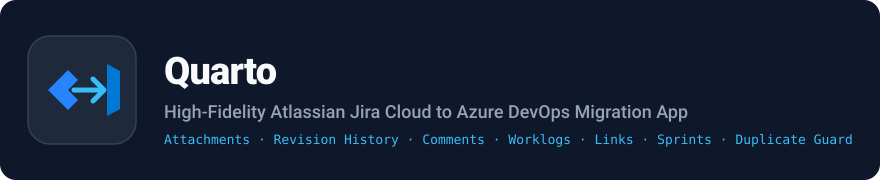

# Jira2ADO — High-Fidelity Jira Cloud to Azure DevOps Migration App



**Jira2ADO** is a zero-command-line, browser-driven migration application and CLI toolkit that migrates **everything** associated with Jira tickets into **Azure DevOps Services** — including full revision history, comments, inline images, attachments, worklogs, parent/child hierarchies, Confluence/web links, Git PR/branch/commit links, sprint iterations, and custom fields.

It runs 100% locally on your machine (`127.0.0.1`) on **macOS, Windows, and Linux**, is **100% read-only on Jira**, and never writes your credentials to disk.

---

## Key Capabilities

1. **100% Browser-Driven Workflow (Zero CLI / Zero YAML Editing Required)**
   - Connect directly with your **Atlassian Jira URL**, **Jira Email**, **Jira API Token**, **Azure DevOps Org URL**, and **ADO PAT** (HTTPS enforced).
   - Select **Jira Project → Jira Board → One or more Sprints (with Filter & Select All Displayed) → Destination ADO Project**.
2. **Interactive Validate & Ticket Review Table**
   - Press **Validate** to fetch and preview all sprint tickets before anything is written to Azure DevOps.
   - Displays **Issue Key**, **Issue Type**, **Summary**, **Assignee**, **Status (Interactive Dropdown)**, and **Outcome**.
   - **Dynamic Status Discovery & Highlighted Recommendations**: Queries both Jira and your destination Azure DevOps project for live workflow states and state categories (`Proposed`, `InProgress`, `Resolved`, `Completed`), prioritizing exact 1:1 state matches and highlighting recommended closest states with a **`★ Recommended`** badge when no identically named state exists in ADO.
   - **Per-Ticket & Bulk Status Overrides**: Change the target ADO state on any individual ticket or apply a status mapping across all tickets with one click.
3. **3-Way Duplicate Detection & Safe Resolution**
   - Automatically highlights tickets that already exist in ADO (by **Exact Jira Key tag/field**, **Jira Key in Title**, or **Matching Summary**) as well as duplicate summaries within the same sprint.
   - Choose per-ticket or in bulk: **Skip**, **Create Duplicate** (tagged & linked), or **Sync Delta** (safely restricted to exact Jira key matches).
4. **Idempotent Retry & Self-Healing Resume**
   - Every work item creation and revision is journaled and verified against live Azure DevOps revisions before writing. If a run is stopped or interrupted, clicking **Retry / Resume Remaining** safely continues without creating duplicates.
4. **Complete Data Fidelity ("EVERYTHING" Migrated)**
   - **Descriptions & Comments**: Full Atlassian Document Format (ADF) and Jira Wiki Markup converted to HTML with resolved `@mentions` (`[~accountid:...]` → human display names) and rewritten cross-ticket links.
   - **Attachments & Inline Images**: Uploaded to Azure DevOps with inline `` and file links rewritten to the uploaded ADO URLs.
   - **Full Revision History**: Chronological replay of status transitions, assignee changes, sprint moves, and field edits with original timestamps and authors (`bypassRules`).
   - **Worklogs & Time Tracking**: `OriginalEstimate`, `CompletedWork`, `RemainingWork`, and worklog history entries.
   - **Hierarchy & Links**: Parent/child links (with optional out-of-sprint parent Epic/Story auto-resolution), `Blocks`/`Relates`/`Duplicates` links, remote Confluence/web links, and Git PR/branch/commit links.
   - **Sprint Auto-Creation & Team Board Subscription**: Creates sprint iterations with start/end dates and subscribes the target ADO team so migrated items appear immediately on the ADO Sprint Board.
   - **Ticket Inspector Drawer, Inline User Mapper & One-Click Rollback**: Inspect any ticket's HTML preview, history timeline, and custom fields; edit user mappings inline; verify every migrated item; or roll back a test run with one click.

---

## Quick Start (Run in Browser)

### Option 1: One-Click Local Launchers (No Command Line Needed)
1. Download or clone this repository.
2. Launch for your operating system:
   - **macOS**: Double-click **`Start jira2ado.command`** in Finder (or run `bash ui.sh`).
   - **Windows**: Double-click **`Start-Jira2ADO.bat`** in File Explorer.
3. Your default browser will open `http://127.0.0.1:<port>` automatically.

### Option 2: Install via `pip`
```bash
cd jira2ado
pip install -e .
jira2ado-ui
```

### Option 3: Run via Docker
```bash
cd jira2ado
docker build -t jira2ado .
docker run --rm -p 8765:8765 jira2ado
```

### Option 4: Standalone Executables (GitHub Releases)
Every tagged release (`v*`) automatically builds standalone **`Jira2ADO-Windows.exe`** and **`Jira2ADO-macOS`** executables via [`.github/workflows/release.yml`](.github/workflows/release.yml) that run without Python installed.

---

## Step-by-Step Usage Guide

1. **Connect**: Enter your **Atlassian Jira URL**, **Jira Email**, **Jira API Token**, **Azure DevOps Org URL**, and **ADO PAT**, then click **Connect**.
2. **Select Scope**:
   - Choose your **Jira Project**, **Jira Board**, and **one or more Sprints**.
   - Choose your **Destination ADO Project** (and optional Iteration/Area Path overrides).
3. **Validate & Review**:
   - Click **Validate**. Review the ticket table, inspect any ticket in the **Ticket Inspector Drawer**, adjust any **Status** dropdowns, and choose **Skip / Create Duplicate / Sync Delta** for any highlighted duplicates.
   - Optionally review or edit **People Identity Mappings** and export the validation preview to CSV.
4. **Migrate & Verify**:
   - Click **Migrate**, confirm the destination project, and watch real-time progress as work items, attachments, history, comments, and links are created and verified in Azure DevOps.

For detailed admin setup, PAT scopes, rule-bypass permissions, and troubleshooting, see [**docs/HELP.md**](docs/HELP.md) or click **`? Help & Setup Guide`** inside the web app.

---

## Command-Line Interface (Optional for CI/Automation)

Every action in the browser app is also available via the `jira2ado` CLI:

```bash
# Full interactive CLI workflow
bash run.sh --from PROJ --to "Destination Project" --sprint "Sprint 28"

# Individual CLI subcommands
python -m jira2ado prepare --from PROJ --board 12 --to "Destination Project" --sprint "Sprint 28" --include-hierarchy
python -m jira2ado -c runs/.../config.yaml access
python -m jira2ado -c runs/.../config.yaml export --force
python -m jira2ado -c runs/.../config.yaml users
python -m jira2ado -c runs/.../config.yaml check --online
python -m jira2ado -c runs/.../config.yaml plan
python -m jira2ado -c runs/.../config.yaml import --possible-duplicates skip
python -m jira2ado -c runs/.../config.yaml verify --report verify.csv
python -m jira2ado -c runs/.../config.yaml rollback
```

---

## Running Tests

```bash
python tests/test_all.py
```

---

## License

MIT License — see [LICENSE](LICENSE).
